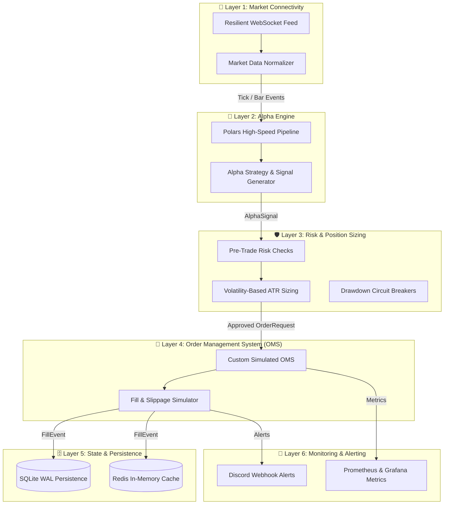

# MultiQuant: Institutional-Grade Quantitative Trading System

[](https://github.com/Xplosion97/MultiQuant/actions/workflows/ci.yml)
[](https://www.python.org/)
[](https://github.com/astral-sh/ruff)
[](https://mypy-lang.org/)

MultiQuant เป็นระบบ Quantitative Trading แบบแยกส่วน (Decoupled Modular Architecture) 6 ชั้น รองรับการประมวลผลความเร็วสูง (High-throughput), ระบบบริหารความเสี่ยงระดับสถาบัน (Risk Management), และการทดสอบอัตโนมัติ 100% ผ่าน GitHub Actions CI

---

## 🏛️ สถาปัตยกรรมระบบ 6 ชั้น (The 6-Layer Architecture)



---

## 📁 โครงสร้างโปรเจกต์ (Repository Directory)

```text
MultiQuant/
├── .github/workflows/ci.yml       # GitHub Actions CI (Ruff, MyPy, Matrix Pytest, Redis)
├── config/                        # การตั้งค่าระบบ (Pydantic Settings & YAML)
│   ├── settings.py
├── src/
│   ├── core/                      # Data models & EventBus (TickData, BarData, AlphaSignal, etc.)
│   ├── layer1_connectivity/       # 📡 Layer 1: Resilient WebSocket, Feed Normalizer
│   ├── layer2_alpha/              # 🧠 Layer 2: Polars-based Alpha Engine (Next)
│   ├── layer3_risk/               # 🛡️ Layer 3: Volatility & ATR Position Sizer (Next)
│   ├── layer4_oms/                # 🛒 Layer 4: Simulated Order Management System (Next)
│   ├── layer5_state/              # 🗄️ Layer 5: SQLite WAL & Redis Cache (Next)
│   └── layer6_monitoring/         # 🚨 Layer 6: Discord & Prometheus/Grafana (Next)
├── research/                      # สคริปต์ Research เดิม (ML, SMC, Compare assets)
├── tests/                         # Unit & Integration Tests ทุก Layer
├── pyproject.toml                 # Ruff, MyPy, Pytest configurations
└── requirements.txt               # Dependencies
```

---

## 🚀 การติดตั้งและทดสอบ (Getting Started)

### 1. ติดตั้ง Dependencies
```bash
python -m venv venv
# บน Windows
.\venv\Scripts\activate
# ติดตั้ง Library
pip install -r requirements.txt
```

### 2. รัน Unit Tests และตรวจคุณภาพโค้ด
```bash
# รัน Unit Tests พร้อมเช็ค Coverage
pytest -v --cov=src

# รัน Linter
ruff check .

# รัน Type Checker
mypy src --ignore-missing-imports
```
