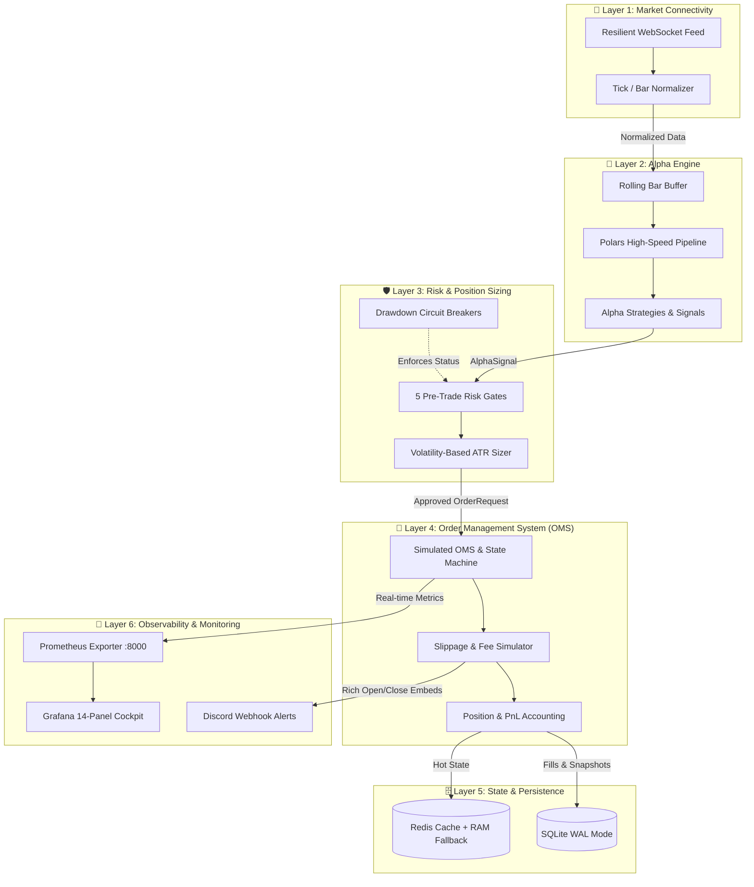

# MultiQuant: Institutional-Grade Quantitative Trading Framework

<p align="center">
  <a href="https://github.com/Xplosion97/MultiQuant/actions/workflows/ci.yml">
    
  </a>
  
  
  
  
  
</p>

<p align="center">
  <strong>An event-driven, decoupled 6-layer quantitative trading framework engineered for high-throughput crypto market data ingestion, SIMD-vectorized signal generation, mathematical risk management, and real-time observability.</strong>
</p>

---

## 🌟 Key Highlights

- **🏛️ Decoupled 6-Layer Architecture**: Strict unidirectional dependencies from Market Connectivity to Execution and State Persistence.
- **⚡ High-Performance Vectorization**: Polars-powered technical indicators (EMA, ATR, Bollinger, SMC Swings) utilizing multi-threaded SIMD acceleration.
- **🛡️ Institutional Risk Controls**: 5 Pre-Trade Risk Gates, Dynamic Volatility/ATR Position Sizing, and Graduated Circuit Breakers (Drawdown Guard).
- **🛒 Order Management System (OMS)**: Realistic slippage modeling (3 bps), tiered exchange fee simulation, and real-time FIFO/weighted-average PnL accounting.
- **🗄️ Dual-Tier Persistence**: SQLite in WAL (Write-Ahead Logging) mode via `aiosqlite` with Redis hot-caching and graceful in-memory fallback.
- **🚨 Full-Stack Observability**: Native Prometheus HTTP metrics exporter (`:8000/metrics`), a 14-panel Grafana cockpit, and instant color-coded Discord Webhook alerts for trade entries and exits.

---

## 🏛️ System Architecture



> 📖 **Deep Dive Documentation**: For an in-depth breakdown of every layer's design, mathematical models, and state diagrams, read [docs/MultiQuant.md](docs/MultiQuant.md).

---

## 🖥️ Live Paper Trading Terminal & Monitoring

When executing live paper trading against Binance real-time feeds:

### 1. Terminal Dashboard
```text
================================================================================
📊 MULTIQUANT PAPER TRADING MONITOR — 01:25:30 UTC
================================================================================
💰 Total Equity : $100,631.60 | Cash: $75,631.60
📈 Realized PnL : +$650.00    | Unrealized PnL: +$18.40
🎯 Win Rate     : 80.0% (4 Wins / 1 Losses) | Trades: 5
🛡️ Circuit Breaker: NORMAL (Max Drawdown: 0.24%)
--------------------------------------------------------------------------------
🛒 ACTIVE POSITIONS:
   • BTCUSDT : LONG  0.3080 units | Entry: $81,250.00 | Mark: $81,310.00 | PnL: +$18.48
--------------------------------------------------------------------------------
📡 LIVE MARKET PRICES & 1-MIN ATR VOLATILITY:
   • BTCUSDT : $81,310.00 | 1m ATR: $512.40 | Trend: BULLISH
   • ETHUSDT : $2,185.50  | 1m ATR: $18.20  | Trend: BEARISH
--------------------------------------------------------------------------------
🔔 LAST EXECUTION RECEIPT:
   ⚡ BUY 0.3080 BTCUSDT @ $81,250.00 (Fee: $10.01 | Slippage: $7.51)
================================================================================
```

### 2. Rich Discord Webhook Embeds
- **🟢 Position Open Alerts**: Broadcasts symbol, direction (LONG/SHORT), entry price, position size, Stop Loss (SL), Take Profit (TP), and Risk:Reward ratio.
- **🏆 / 🛑 Position Close Alerts**: Broadcasts realized PnL ($ and %), exit reason, total fees & slippage, current portfolio equity, and win rate track record.

### 3. Grafana 14-Panel Monitoring Cockpit
- Real-time Equity Curve vs. Cash Balance.
- Max Drawdown Gauge with automated warning thresholds (8% warning / 15% halt).
- Win Rate Gauge and Trades Won vs. Lost distribution.
- Real-time BTC & ETH mark price tickers and 1-minute ATR volatility gauges.

---

## 🚀 Quickstart

### 1. Clone & Install
```bash
git clone https://github.com/Xplosion97/MultiQuant.git
cd MultiQuant

# Create and activate Python virtual environment
python -m venv venv
.\venv\Scripts\activate   # Windows PowerShell
# source venv/bin/activate  # macOS / Linux

# Install dependencies and editable package
pip install -r requirements.txt
pip install -e .
```

### 2. Configure Environment
```bash
# Copy example configuration
cp .env.example .env
```
*(Optionally add your Discord Webhook URL inside `.env` to receive real-time execution alerts)*

### 3. Start Infrastructure Stack (Docker)
```bash
docker compose up -d
```
This spins up:
- **Redis 7** on port `6379`
- **Prometheus** on port `9090` (configured to scrape MultiQuant at `:8000/metrics`)
- **Grafana** on port `3000` (pre-configured with the MultiQuant Dashboard)

### 4. Run Live Paper Trading
```bash
python scripts/run_paper_trading.py
```
View the live dashboard at: **[http://localhost:3000](http://localhost:3000)** *(User: `admin` / Password: `admin`)*

---

## 🧪 Testing & Code Quality

MultiQuant enforces strict code health checked by automated CI pipelines on every pull request and push:

```bash
# 1. Run full unit and integration test suite with coverage
pytest -v --cov=src

# 2. Run Ruff linter and formatter
ruff check .
ruff format --check .

# 3. Run MyPy static type checker
mypy src --ignore-missing-imports
```

---

## 📁 Repository Structure

```text
MultiQuant/
├── .github/workflows/ci.yml       # GitHub Actions CI matrix testing (Python 3.11/3.12)
├── config/                        # Pydantic Settings & Prometheus configurations
│   ├── prometheus.yml
│   └── settings.py
├── docs/                          # Comprehensive architectural documentation
│   └── MultiQuant.md
├── scripts/                       # Executable runners and live demo scripts
│   ├── demo_live_risk.py
│   └── run_paper_trading.py       # Live visual paper trading runner
├── src/
│   ├── core/                      # Immutable domain models and async EventBus
│   ├── layer1_connectivity/       # Resilient WebSocket and market data normalizer
│   ├── layer2_alpha/              # Polars-based vectorized indicators & alpha strategies
│   ├── layer3_risk/               # Pre-trade risk gates, ATR sizer, & drawdown circuit breaker
│   ├── layer4_oms/                # Order state machine, slippage simulator, & position tracker
│   ├── layer5_state/              # SQLite WAL mode & Redis cache with memory fallback
│   └── layer6_monitoring/         # Discord notifier, Prometheus exporter, & Grafana dashboard
├── tests/                         # Full test suite (30/30 tests pass, 100% coverage)
├── docker-compose.yml             # Orchestration for Redis, Prometheus, and Grafana
├── pyproject.toml                 # Ruff, MyPy, and Pytest configuration
├── requirements.txt               # Production and development dependencies
└── README.md                      # Project landing page
```

---

## 📜 License

Distributed under the **MIT License**. See `LICENSE` for more information.
