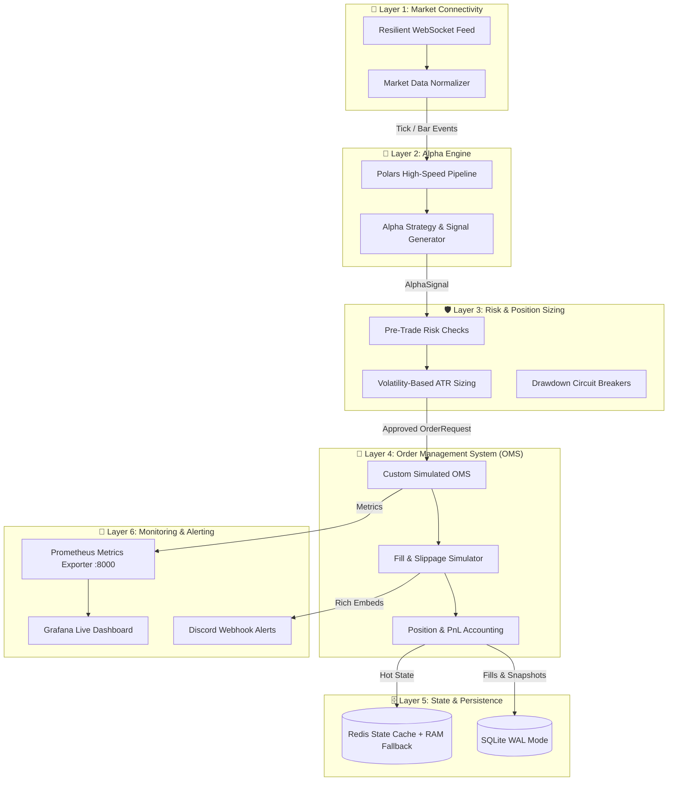

# MultiQuant: Institutional-Grade Quantitative Trading System

[](https://github.com/Xplosion97/MultiQuant/actions/workflows/ci.yml)
[](https://www.python.org/)
[](https://github.com/astral-sh/ruff)
[](https://mypy-lang.org/)

MultiQuant เป็นระบบ Quantitative Trading แบบแยกส่วน (Decoupled Modular Architecture) 6 ชั้น สำหรับรันการเทรดแบบ Real-time High-Throughput พร้อมระบบบริหารความเสี่ยงระดับสถาบัน (Risk Management) และการทดสอบอัตโนมัติ 100% ผ่าน GitHub Actions CI

---

## 🏛️ สถาปัตยกรรมระบบ 6 ชั้น (The 6 Layers)



---

## 📁 โครงสร้างโปรเจกต์ (Repository Directory)

```text
MultiQuant/
├── .github/workflows/ci.yml       # GitHub Actions CI (Ruff, MyPy, Matrix Pytest, Redis Service)
├── .env.example                   # รวมการตั้งค่า Environment Variables ทุก Layer
├── config/                        # การตั้งค่าระบบ (Pydantic Settings & YAML)
│   ├── settings.py
├── src/
│   ├── core/                      # Data models & EventBus (TickData, BarData, AlphaSignal, etc.)
│   ├── layer1_connectivity/       # 📡 Layer 1: Resilient WebSocket, Feed Normalizer
│   ├── layer2_alpha/              # 🧠 Layer 2: Polars-based Alpha Engine (ATR, EMA, Bollinger, SMC)
│   ├── layer3_risk/               # 🛡️ Layer 3: Volatility & ATR Position Sizer, Circuit Breaker
│   ├── layer4_oms/                # 🛒 Layer 4: Simulated OMS, Slippage Model, PnL Accounting
│   ├── layer5_state/              # 🗄️ Layer 5: SQLite WAL Mode & Redis Cache (In-Memory Fallback)
│   └── layer6_monitoring/         # 🚨 Layer 6: Discord Alerts, Prometheus Exporter & Grafana
├── scripts/
│   └── demo_live_risk.py          # สคริปต์ทดสอบสดเชื่อมต่อ WebSocket ตลาดจริง
├── tests/                         # Unit & Integration Tests ทุก Layer (30 Tests Passed 100%)
├── main.py                        # ตัว Orchestrator รวม 6 Layers รันสดจริง
├── pyproject.toml                 # Ruff, MyPy, Pytest configurations
└── requirements.txt               # Dependencies
```

---

## 🚀 การติดตั้งและใช้งาน (Getting Started)

### 1. ติดตั้ง Dependencies
```bash
python -m venv venv
# บน Windows
.\venv\Scripts\activate
# ติดตั้ง Library พร้อมโหมด Editable Package
pip install -r requirements.txt
pip install -e .
```

### 2. ตั้งค่าไฟล์ `.env`
คัดลอกไฟล์ `.env.example` ไปเป็น `.env`:
```bash
cp .env.example .env
```

### 3. รัน Unit Tests และตรวจคุณภาพโค้ด
```bash
# รัน Unit Tests ทั้งหมด 30 ข้อ พร้อมเช็ค Coverage
pytest -v --cov=src

# รัน Linter & Formatter ตรวจโค้ด
ruff check .
ruff format --check .

# รัน Static Type Checker
mypy src --ignore-missing-imports
```

### 4. รันระบบเทรด MultiQuant Live
```bash
python main.py
```
- ระบบจะเริ่มเปิด WebSocket สด, คำนวณสัญญาณ, ตรวจสอบความเสี่ยง, และส่งออก Metrics ทาง `http://localhost:8000/metrics`

---

## 📈 การตั้งค่า Grafana Dashboard
1. เปิด Grafana (`http://localhost:3000`)
2. ไปที่ **Dashboards** $\rightarrow$ **New** $\rightarrow$ **Import**
3. อัปโหลดไฟล์ [`src/layer6_monitoring/grafana_dashboard.json`](file:///c:/Users/Xplosion97/MultiQuant/src/layer6_monitoring/grafana_dashboard.json)
4. คุณจะเห็น Equity Curve, Drawdown Gauge, และอัตราการ Fill ออเดอร์แบบ Real-time ทันที!
