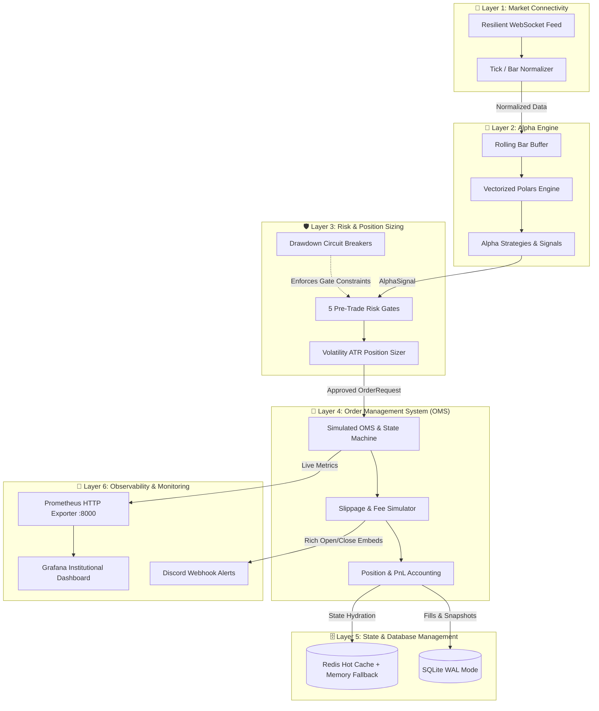

# MultiQuant: Institutional-Grade Quantitative Trading Framework

MultiQuant is a production-engineered, event-driven quantitative trading framework designed with a strictly decoupled 6-layer architecture. Built for high-throughput algorithmic execution, mathematical risk control, and real-time observability, MultiQuant bridges the gap between theoretical quantitative research and high-reliability production trading.

---

## 🏛️ System Architecture Overview

The system is architected around the principle of strict unidirectional dependency and event-driven decoupling. Each layer operates independently with well-defined contracts and interfaces:

---

## 🔍 Deep Dive: The 6 Core Layers

### 📡 Layer 1: Market Connectivity (`src/layer1_connectivity/`)
Responsible for resilient ingress of live market data from cryptocurrency exchanges.
- **Resilient WebSocket Ingestion**: Built on `websockets.asyncio.client` with automated exponential backoff reconnection and random jitter to prevent thundering herd problems during exchange disconnections.
- **Payload Normalization (`MarketDataParser`)**: Translates raw exchange JSON streams (Binance `bookTicker`, `trade`, `kline`) into standardized, immutable domain models (`TickData`, `BarData`).
- **Data Integrity & Schema Validation**: Corrupted or incomplete JSON payloads are safely caught and dropped without panicking the ingestion pipeline.

### 🧠 Layer 2: Alpha Engine (`src/layer2_alpha/`)
Vectorized signal computation using high-performance SIMD-accelerated Polars dataframes.
- **Rolling Bar Buffer (`RollingBarBuffer`)**: Ring-buffer storing fixed-size historical bars per symbol for low-latency conversion into Polars DataFrames.
- **Vectorized Technical Indicators (`indicators.py`)**:
  - **True Range & ATR**: Welles Wilder's Average True Range for dynamic volatility scaling.
  - **Exponential Moving Average (EMA)**: Exponential smoothing for multi-timeframe trend tracking.
  - **Bollinger Bands**: Volatility envelopes based on rolling standard deviations.
  - **Smart Money Concepts (SMC) Swing Identification**: Identification of Swing Highs and Lows for structural liquidity detection.
- **Alpha Strategy Suite**: Decoupled strategy base classes implementing crossover validation, volatility filtering, and signal strength scoring.

### 🛡️ Layer 3: Risk & Position Sizing (`src/layer3_risk/`)
Institutional capital protection enforcing mathematical risk models before any order can reach the execution venue.
- **5 Pre-Trade Risk Gates (`PreTradeRiskManager`)**:
  1. **Kill Switch Gate**: Global halt preventing any new order submissions.
  2. **Circuit Breaker Status Gate**: Checks if system is in `HALT_TRADING` or `REDUCE_RISK` states.
  3. **Symbol Whitelist Gate**: Enforces execution strictly on pre-cleared asset pairs.
  4. **Max Open Positions Gate**: Hard ceiling on concurrently active market positions.
  5. **Notional Order Value & Min Size Gate**: Prevents dust orders or oversized exposures.
- **Volatility-Based ATR Position Sizer (`VolatilityPositionSizer`)**:
  Calculates contract quantity inversely proportional to asset volatility:
  $$\text{Quantity} = \frac{\text{Capital} \times \text{Risk Fraction}}{\text{ATR} \times \text{Risk Multiplier}}$$
- **Graduated Drawdown Circuit Breaker (`DrawdownGuard`)**:
  Monitors peak-to-trough equity drawdowns in real time:
  - $\text{Drawdown} < 8\%$: **NORMAL** (Standard execution).
  - $8\% \le \text{Drawdown} < 15\%$: **REDUCE_RISK** (Halves allowed position sizing).
  - $\text{Drawdown} \ge 15\%$: **HALT_TRADING** (Immediate trading cessation and protective order cancellation).

### 🛒 Layer 4: Order Management System (OMS) (`src/layer4_oms/`)
Full-lifecycle order management, matching simulation, and accurate portfolio accounting.
- **Order State Machine (`order_state.py`)**:
  Enforces strict state transitions (`PENDING` $\rightarrow$ `ACCEPTED` $\rightarrow$ `FILLED` / `CANCELED` / `REJECTED`). Disallows illegal transitions (e.g., executing an already canceled order).
- **Realistic Execution Simulation (`execution_sim.py`)**:
  - Incorporates dynamic slippage models (default 3 bps proportional to order size).
  - Simulates tiered exchange maker/taker fees (default 0.04% / 4 bps).
- **Position & PnL Accounting (`position_tracker.py`)**:
  - Maintains weighted average entry prices for scaled entries.
  - Accurate realization of profit/loss upon partial or full position closures.
  - Real-time mark-to-market unrealized PnL valuation.

### 🗄️ Layer 5: State & Database Management (`src/layer5_state/`)
Dual-tier state persistence guaranteeing data durability and ultra-fast cache access.
- **Persistent Tier (`SQLiteStore`)**:
  - Async I/O powered by `aiosqlite`.
  - Configured with `PRAGMA journal_mode=WAL` (Write-Ahead Logging) for concurrent read/write throughput without blocking.
  - Automatic table migrations for Orders, Fills, and Portfolio Snapshots.
- **Hot Caching Tier (`RedisCache`)**:
  - In-memory key-value storage using `redis.asyncio` for tick data and state hydration.
  - **Graceful In-Memory Fallback**: If Redis is unreachable or offline, automatically degrades to an in-memory Python dictionary without interrupting the trading engine.

### 🚨 Layer 6: Observability & Monitoring (`src/layer6_monitoring/`)
Real-time metrics, rich notifications, and full-stack operational visibility.
- **Prometheus HTTP Exporter (`metrics.py`)**:
  Publishes quant metrics on port `:8000/metrics`:
  - `multiquant_portfolio_equity_usd` & `multiquant_portfolio_cash_usd`
  - `multiquant_realized_pnl_usd` & `multiquant_unrealized_pnl_usd`
  - `multiquant_portfolio_drawdown_pct` & `multiquant_win_rate_pct`
  - `multiquant_fees_paid_usd_total` & `multiquant_slippage_paid_usd_total`
  - `multiquant_market_price_usd` & `multiquant_atr_volatility_usd`
- **14-Panel Grafana Dashboard (`grafana_dashboard.json`)**:
  Pre-configured dark-mode monitoring cockpit featuring KPI stat panels, live price trackers, equity/cash curves, and execution fill throughput.
- **Discord Webhook Notifier (`discord_notifier.py`)**:
  Color-coded rich embed dispatching:
  - 🟢 **Trade Open**: Symbol, Direction (LONG/SHORT), Entry Price, Position Size, Stop Loss (SL), Take Profit (TP), and Risk:Reward.
  - 🏆 / 🛑 **Trade Close**: Realized PnL ($ and %), Exit Price, Exit Reason, Total Fees/Slippage, and Cumulative Win Rate.
  - 🚨 **Circuit Breaker Alerts**: Immediate notifications if drawdown thresholds are breached.

---

## 🛠️ Testing & Quality Assurance

The codebase adheres to strict software engineering standards verified by GitHub Actions CI:
- **100% Test Pass Rate**: 30 comprehensive unit and integration tests across all 6 layers.
- **Static Typing**: Checked with `mypy src --ignore-missing-imports`.
- **Linting & Formatting**: Checked with `ruff check .` and `ruff format --check .`.
- **Containerized Infrastructure**: Docker Compose orchestration for Redis, Prometheus, and Grafana.

---

## 📈 Roadmap & Production Progression

| Stage | Mode | Capital | Focus |
| :--- | :--- | :--- | :--- |
| **Stage 1 (Current)** | **Live Paper Trading** | Simulated ($100k) | Execution simulation against live Binance WebSocket data, risk gate validation, and metric telemetry. |
| **Stage 2** | **Exchange Testnet** | Free Testnet ($10k) | Direct API order routing to Binance Futures Testnet, testing network latency, API keys, and rate limits. |
| **Stage 3** | **Live Micro Capital** | Real Capital ($20-$50) | Validating real-world exchange slippage, maker/taker fee tiers, and real liquidity book depth. |
| **Stage 4** | **Production Scale** | Full Institutional | Scaled portfolio deployment across multi-asset crypto and equities markets. |
